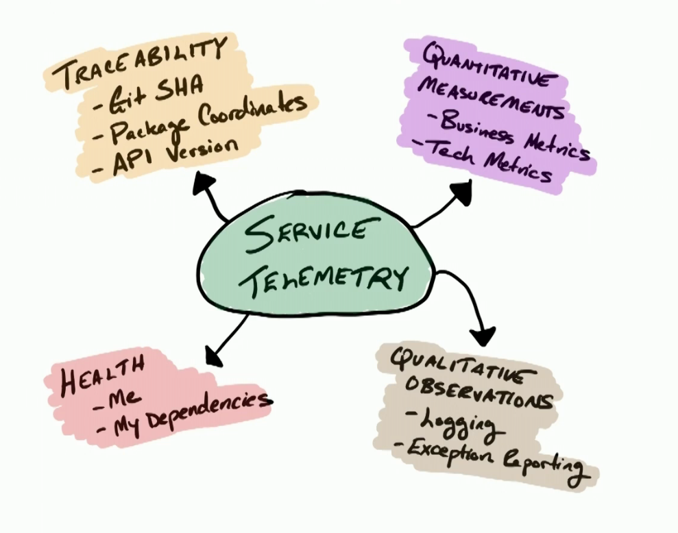
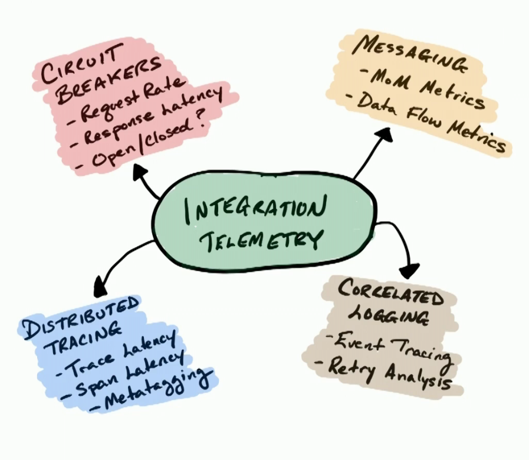

# Observability

Created By: Álvaro Bautista Pino
Last Edited: July 19, 2022 8:49 AM

[Logging](Observability/Logging.md)

- How to Build Observable Distributed Systems [https://www.infoq.com/presentations/observable-distributed-ststems](https://www.infoq.com/presentations/observable-distributed-ststems)
- "What is Happening: Attempting to Understand Our Systems" by Beau Lyddon [https://www.youtube.com/watch?v=xy3w2hGijhE](https://www.youtube.com/watch?v=xy3w2hGijhE) Gives recommendations on how to achieve observability (passing context around, structured logs, tracing, etc)
- Unpacking Observability [https://storiesfromtheherd.com/unpacking-observability-a-beginners-guide-833258a0591f](https://storiesfromtheherd.com/unpacking-observability-a-beginners-guide-833258a0591f)
- "Observability for Emerging Infra: What Got You Here Won't Get You There" by Charity Majors [https://www.youtube.com/watch?feature=youtu.be&v=1wjovFSCGhE](https://www.youtube.com/watch?feature=youtu.be&v=1wjovFSCGhE)
- Monitoring and Observability — What’s the Difference and Why Does It Matter? [https://thenewstack.io/monitoring-and-observability-whats-the-difference-and-why-does-it-matter/](https://thenewstack.io/monitoring-and-observability-whats-the-difference-and-why-does-it-matter/)
    - Observability is a property of a system, not a thing you do. You monitor, you trace, etc and all that affects the observability of the system.
- Observability for Developers https://www.honeycomb.io/wp-content/uploads/2018/12/Observability-for-Developers-ebook-Dec-7-2018-.pdf
- Operable Software [https://ferd.ca/operable-software.html](https://ferd.ca/operable-software.html)
    - Includes a section about observability
- Observability?! – Where do we go from here? [https://blog.mi.hdm-stuttgart.de/index.php/2019/02/09/observability-where-do-we-go-from-here/](https://blog.mi.hdm-stuttgart.de/index.php/2019/02/09/observability-where-do-we-go-from-here/)
- Domain-Oriented Observability https://martinfowler.com/articles/domain-oriented-observability.html
    - How to implement observability instrumentation within the domain without clogging it with details.
    - Domain-Probe: a high-level instrumentation API that is oriented around domain semantics, encapsulating the low-level instrumentation plumbing required to achieve Domain-Oriented Observability
- Canonical Log Lines [https://stripe.com/gb/blog/canonical-log-lines](https://stripe.com/gb/blog/canonical-log-lines)

**What to measure?**

In this Learning Path [https://learning.oreilly.com/learning-paths/learning-path-cloud/9781491984499/9781491988268-video323815](https://learning.oreilly.com/learning-paths/learning-path-cloud/9781491984499/9781491988268-video323815) there's a good bunch of example things to take into account from two standpoints, within a service and on the integration of services (nodes and edges):

