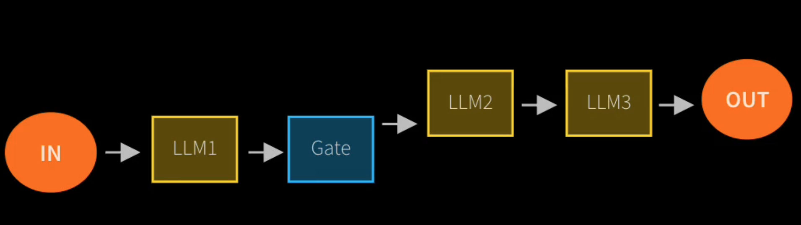
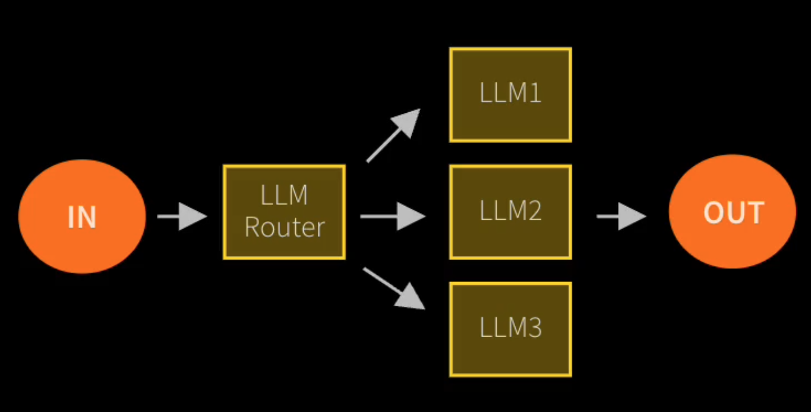
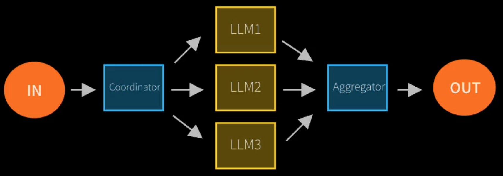
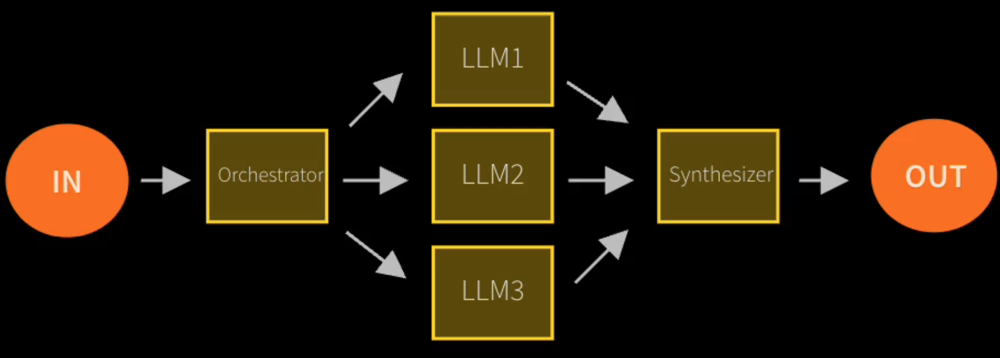
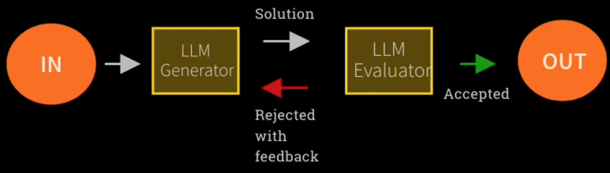

# Workflow Design Patterns

## Prompt Chaining

Decompose into fixed sub-tasks.

## Routing

Direct an input into an specialized sub-task, ensuring separation of concerns.

## Parallelization

Breaking down tasks and running multiple subtasks concurrently.

## Orchestrator-Worker

Complex tasks are broke down dynamically and combined

## Evaluator-Optimizer

LLM output is validated by another

