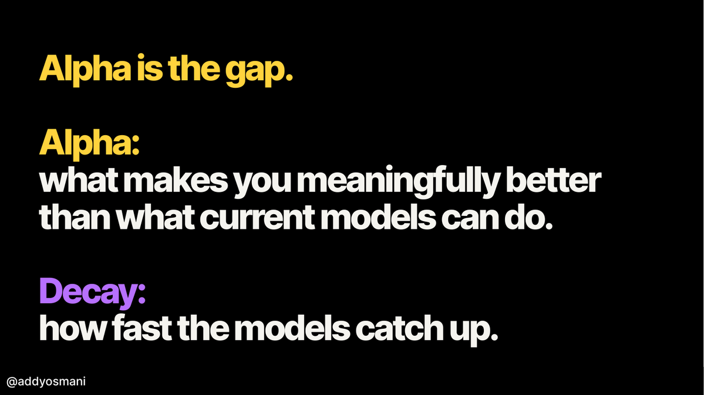
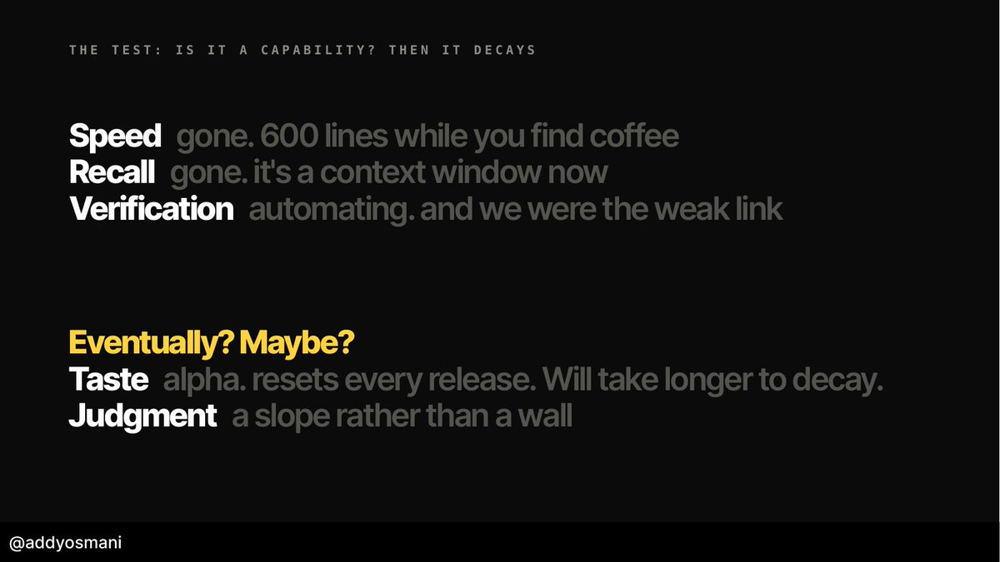
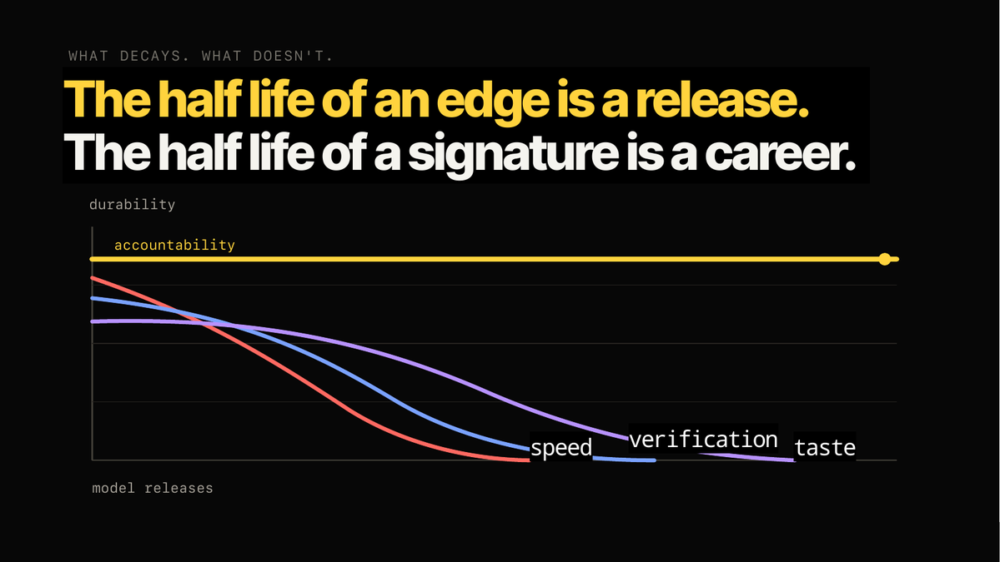

# Alpha, Decay, and Taste

**Source:** [Own the Outer Loop](https://x.com/addyosmani/status/2074927530482835916) - Addy Osmani, 2026-07-08

**Companion piece:** [Own the Outer Loop](../../coding/own-the-outer-loop.md)

## Summary

Osmani offers a simple model for what a skill is worth in the agentic era. **Alpha** is the gap between what you can do and what current models can do — the margin that makes you meaningfully better. **Decay** is how fast the models close that margin. Every capability you hold has both: a lead, and a rate at which the lead erodes with each model release.

The test he proposes is blunt: **if it's a capability, it decays.** Speed, recall and verification are capabilities, so they're already gone or going. **Taste** — judgment made before a metric exists — decays slowly, because it resets with every release. **Accountability** doesn't decay at all, because it isn't a capability. That asymmetry is the whole argument for moving your career weight from doing the work to owning it.

## Alpha and decay

- **Alpha** — what makes you meaningfully better than what current models can do.
- **Decay** — how fast the models catch up.
- Alpha is not a fixed property of a skill. It's a *gap*, so it moves whenever either side moves — and lately only one side is moving.

## The test: is it a capability? Then it decays

Osmani sorts skills by asking whether they're capabilities:

- **Speed — gone.** "600 lines while you find coffee."
- **Recall — gone.** "It's a context window now."
- **Verification — automating.** And, pointedly, *we were the weak link* — the source's own numbers say 96% don't fully trust AI code while only 48% always verify it.
- **Taste — alpha.** Resets every release, so it takes longer to decay.
- **Judgment — a slope rather than a wall.** It degrades gradually, not abruptly.

The three that are already gone or going are exactly the ones engineers historically sold themselves on.

## Taste is the judgment before the metric exists

- Taste is **the earliest point at which you can sense a lead opening (alpha) or a plateau setting in (decay)** — judgment of what's coming before there's evidence anything is happening.
- Two framings Osmani leans on: Paul Graham's — when anyone can make anything, *choosing what to make* matters more — and Mitchell Hashimoto's operational one: **making high-quality qualitative judgments where no objective metric exists yet.**
- Properties that make taste economically strange: **hard to create, easy to copy, valuable because it decides what everyone copies next.**
- Alpha shifts *are* taste changes; decays set in because people start to taste something different.

**Operationalising taste:** give it a name (move it from limbic to conscious), practise it in critique and examples, make its rationale explicit.

## What doesn't decay: accountability

Plotted against model releases, speed decays fastest, verification next, taste slowest of the three — but all three fall to the baseline. **Accountability runs flat.**

- *"The half-life of an edge is one release. The half-life of a signature is a career."*
- A **signature** is your name on the work, such that you can stand behind what shipped.
- **Skills get you leverage; accountability turns leverage into trust.**
- Accountability survives because it isn't a capability at all: agents can choose, route, merge and escalate inside a policy, but **only people inherit consequences**. Nothing in a model release changes that.
- The career move that follows: keep pushing your edge up from *doing* the task to teaching it, systematising it, deciding when it should be done, and owning the result — which is the top of [The Agency Ladder](../../coding/agency-ladder.md).

## Core Insight

Sort every skill you have by asking whether a model could hold it. If it could, it's a capability and it's on a decay curve — invest in it only for the leverage it buys you today, not for the career it won't sustain. **Taste buys you the longest runway because it resets with every release, and accountability buys you an unlimited one because it was never a capability to begin with.** Alpha is rented; a signature is owned.
