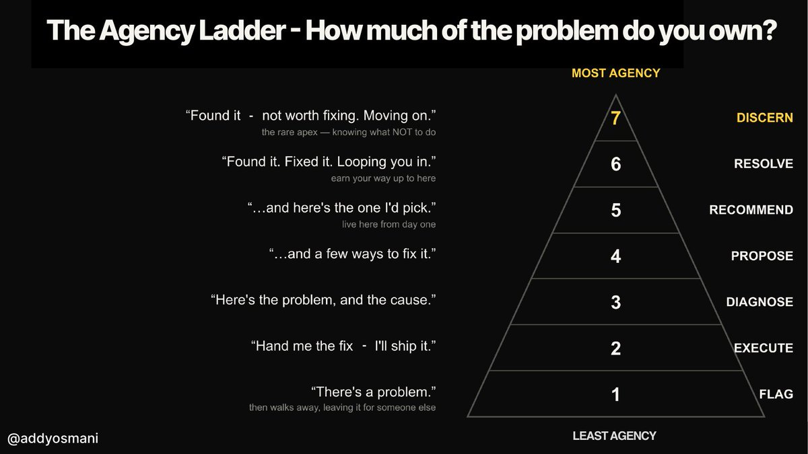

# The Agency Ladder

**Source:** [Own the Outer Loop](https://x.com/addyosmani/status/2074927530482835916) - Addy Osmani, 2026-07-08

**Companion piece:** [Own the Outer Loop](./own-the-outer-loop.md)

## Summary

High agency is the art of knowing **when to delegate, when to inspect, when to stop, and when to own the result** of a process. The Agency Ladder makes that concrete: seven ascending levels that answer a single question — *how much of the problem do you own?* At the bottom you notice a problem and hand it off; at the top you decide it isn't worth fixing and move on.

The ladder is useful in two directions. It's a self-assessment for engineers (where do you habitually operate, and where should you?), and it's a specification for agents (which rung is an agent permitted to reach before a human takes over). Both readings point at the same boundary: rungs 1–5 produce evidence and options, while rungs 6–7 are acts of ownership.

## The seven rungs

From least to most agency:

1. **Flag** — *"There's a problem."* Then walks away, leaving it for someone else.
2. **Execute** — *"Hand me the fix — I'll ship it."* Willing hands, no diagnosis.
3. **Diagnose** — *"Here's the problem, and the cause."*
4. **Propose** — *"...and a few ways to fix it."*
5. **Recommend** — *"...and here's the one I'd pick."* **Live here from day one.**
6. **Resolve** — *"Found it. Fixed it. Looping you in."* **Earn your way up to here.**
7. **Discern** — *"Found it — not worth fixing. Moving on."* The rare apex: knowing what **not** to do.

## What the rungs are actually measuring

- **Flag and Execute are the lowest forms of agency**, and they are opposite failures of the same kind. Flagging surfaces a problem without carrying it; executing carries a fix without understanding it. Neither takes ownership of the problem itself.
- **Diagnose → Propose → Recommend is a single escalating commitment.** Each rung adds something the next person no longer has to do: the cause, the option set, the choice. Recommend is where a competent person starts — not a milestone to work toward.
- **Resolve is earned, not assumed.** Acting and then informing requires a track record; it's the rung where trust, rather than skill, is the gating factor.
- **Discern is the apex because it's subtractive.** Deciding something isn't worth fixing produces no artifact, can't be measured by output, and is only defensible if you can explain the judgment. It's the rung most easily mistaken for negligence — which is exactly why it demands the most ownership.

## Reading the ladder for agents

The ladder doubles as a delegation contract. Agents can be asked to climb it *inside a policy* — flag, investigate, diagnose, propose, even resolve — but the higher rungs assume something an agent cannot supply: **only people inherit consequences.**

- Rungs 1–5 are **capability**: investigate, generate options, report. This is what the inner loop does well, and what an agent can be trusted with by default.
- Rungs 6–7 are **agency**: acting on your own judgment and being answerable for it afterwards. An agent may execute at these rungs under an explicit grant, but the ownership stays with whoever granted it.
- **Discern is the hardest rung to delegate.** An agent that decides a problem isn't worth fixing has made an unrecorded, hard-to-audit decision — precisely the failure mode that long-horizon agents make expensive to reconstruct.

Used this way, the ladder is a back-pressure dial: *how high on this ladder is the agent allowed to go before evidence has to cross the boundary to a human?*

## Core Insight

**The ladder measures ownership, not competence.** Every rung above Flag can be reached with the same technical skill; what changes is how much of the problem you carry rather than pass along. That makes it a scale you can apply to a person, a team, or an agent grant without changing the question.

Two rungs deserve special attention: **Recommend is the floor**, not an achievement — arriving with a problem and no opinion pushes the real work onto someone else. And **Discern is the top** because the scarcest judgment is deciding what doesn't deserve to be done at all, which is the same capacity described in [Alpha, Decay, and Taste](../ai-engineering/principles/alpha-decay-and-taste.md) as taste: the judgment before the metric exists.
