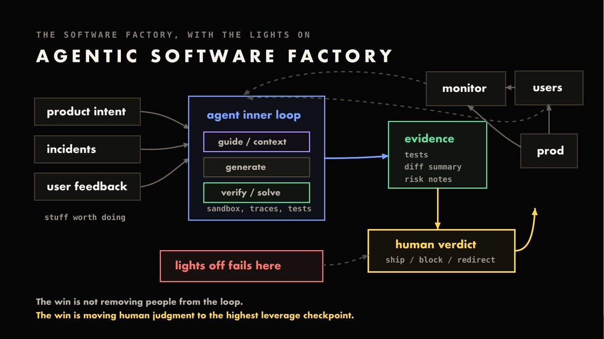
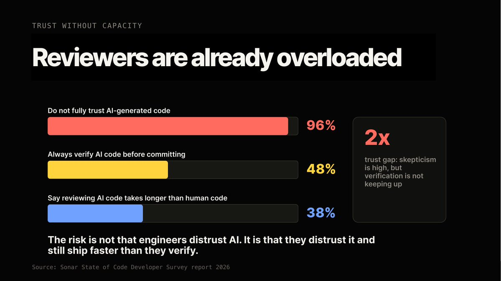

# Own the Outer Loop

**Source:** [Own the Outer Loop](https://x.com/addyosmani/status/2074927530482835916) - Addy Osmani, 2026-07-08

## Summary

The conversation around agentic engineering has moved to harnesses, loops, fleets, and software factories. Addy Osmani's argument is that none of this removes the engineer — it relocates them. **Agents run the inner loop** (investigate, implement, test, report). **Engineers own the outer loop** (decide, verify, approve, own). The thing that crosses between the two is **evidence**: a diff, tests, logs, and a "why". The engineer of the future chooses what is worth doing, then owns the evidence, understanding, and verdict for work that agents increasingly automate.

The reason the boundary matters is accountability. Agents have leverage, and leverage creates obligations: someone must be able to explain exactly what changed, why it was safe, and what happens if they're wrong. The inner loop is **capability**; the outer loop is **agency**. Automation executes inside a policy — accountability owns the blast radius.

## Three Terms: Quality, Verdict, Answerability

- **Quality** — all the checks installed *before* the system is let loose. Those checks produce the evidence from which a verdict is derived.
- **Verdict** — the production decision made before work enters your dependent system: ship, block, redirect, narrow, add a guardrail, or reject outright. "The model may write the line, but the Verdict is mine."
- **Answerability** — the guarantee that if someone asks, you can explain why. Without it, agent actions can't be justified — which makes it unlikely an organization asks for them at all.

Definitions Osmani works from: an **agent** is a model plus a harness (files, tools, memory, skills, sandboxes, permissions, observability, recovery). A **loop** is investigate → implement → verify → repeat. Together they make the software factory.

## The Boundary Is Evidence

- Inside the system: inputs arrive (product intent, prior shipped work, incidents, user feedback). The agent investigates, implements, verifies.
- **Evidence crosses the boundary.** A human who owns the dependent system sees it and decides whether to proceed.
- Constraints and learning flow back the other way, shaping the next run.
- Full "lights-off" automation fails precisely at the judgment step — the win is not removing people from the loop, but **moving human judgment to the highest-leverage checkpoint**.

## Why the Gap Is Widening

Generation got faster than control, producing a **trust-verification gap**.

- **42%** of committed code is already AI-generated or significantly AI-assisted (Sonar, 2026), up from 6% in 2023 and rising.
- **96%** don't fully trust AI-generated code, but only **48%** always verify before committing — roughly a 2:1 gap between stated skepticism and actual behaviour.
- **85%** say review/validation is now the bottleneck; **84%** say governance happens *after* creation, i.e. after the risk is accepted (GitLab, June 2026).
- Delegation depth is real: **70%** of agent tasks are >1 hour human-equivalent, **26%** are >8 hours; >60h of agent turns per day for p99 internal daily active users (OpenAI, June 2026).

Long-horizon agents make answerability structural rather than optional: hour-scale runs make decisions that aren't all recorded and can't be traced back to input tokens. Reconstructing that chain after the fact costs hundreds or thousands of human hours — so it has to be designed in.

**Creation is getting cheaper. The scarce resources are review, validation, understanding, and maintenance.**

## Back-Pressure, Not Maximum Autonomy

> "We don't want to grant our agents as much autonomy as they can possibly exercise. We want to grant them just enough autonomy that we have enough back pressure to stop them, regulate them, check their work, and ensure our humanity."

Ordinary engineering already emits the signals that create back pressure: **type checks, tests, hooks, sandbox limits, audit logs, monitors**. As long as agents emit those same signals, ordinary engineering supplies appropriate back pressure — no need to invent a parallel control system.

Trusting your systems doesn't mean removing the human. It means the human doesn't need to be in the *inner* loop. They stay in four other loops:

- **Constraints loop** — what inputs, architectures, instructions, or invariants should we set?
- **Sampling loop** — how much output should we sample and review?
- **Audit loop** — what evidence should we keep, and how do we make the audit log effective?
- **Ownership loop** — what part of the production boundary should we own?

Because **the agent can ship more than you can review**, the scarce resource becomes your own judgment, informed by quality signals like logs and tests.

## The Operating Model

- Put **all quality assurance and verification inside the loop**, and design loops to be as independent as possible.
- Once the loop itself is designed and validated, the remaining job is granting autonomy via a **back-pressure mechanism** that controls the rate at which the loop runs and its scope of operation.
- Put humans on the **right decisions** — not as a hand-off or release gate, but at a point of decision where they're primed to contribute insight.
- Leave behind **better artifacts** for every artifact fed back into production, new teams, and new engineers.
- Consider an **accountability contract** per codebase: the checklist understood when the change was accepted, the evidence behind the decision, who was accountable, and the system status after.

Brownfield is the hard frontier: the behaviour you must audit doesn't live in the code, it lives in the scars — production behaviour, migration histories, unspoken assumptions, data weirdness, runbooks. Stewarding it means turning implicit knowledge into explicit constraints, formalizing it into tests and specs, and tying it to objective evidence.

## Core Insight

The bottleneck moves from **"can we build this?"** to **"should this exist, and can we answer for it?"** An agent can write the code, but before it reaches users someone must explain why it should exist, why it's safe enough for production, and what they'll do when it's wrong.

Only people inherit consequence. Agents can choose, route, merge, and escalate safely inside a policy — they cannot carry the blast radius. Accountability is not what's left over once agents get good; **it's what lets the rest scale**. Skills get you leverage; accountability turns leverage into trust.

**Build the factory; keep the lights on; make work legible, verifiable, owned.**

## Related notes

- [The Agency Ladder](./agency-ladder.md) — the seven ascending levels of problem ownership, from flagging a problem to the apex judgment that it isn't worth fixing.
- [Alpha, Decay, and Taste](../ai-engineering/principles/alpha-decay-and-taste.md) — which skills models erode and which hold their value: speed and recall are gone, taste and judgment decay slowest, accountability doesn't decay at all.
