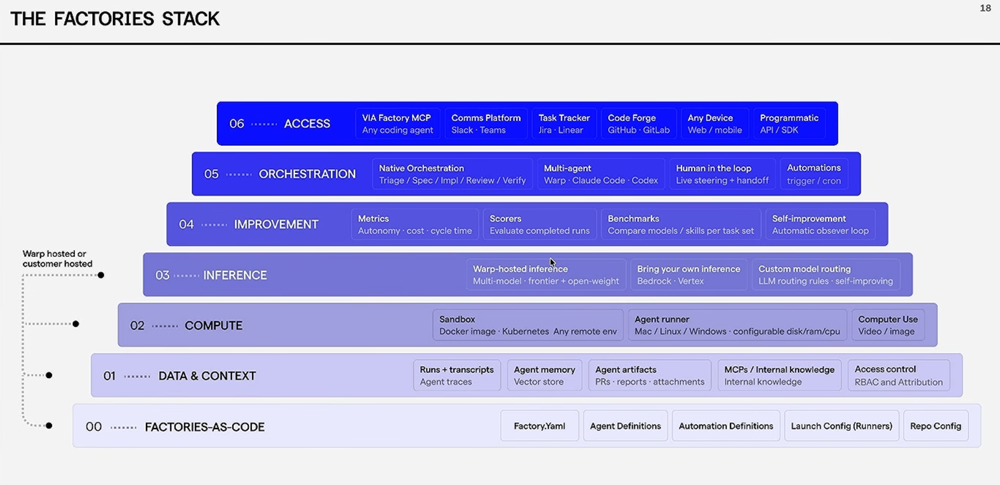

# How to Build a Software Factory That Improves Itself

**Source:** [How to Build a Software Factory That Improves Itself - Zach Lloyd, Warp](https://www.youtube.com/watch?v=nKjPBAw_N_0)

## Summary

Zach Lloyd is the founder of Warp and used to lead engineering on Google Docs. He argues that most companies are stuck at **interactive prompting**: engineers drive Claude Code or Codex from their laptops. Where companies want to be is **automated development**. Interactive local agents hit three limits. A person has to run each one. Costs are hard to control when everyone has their own setup. And they are hard to govern and secure, because a compromised local agent can act as the signed-in user, and nobody can see or audit everyone's own MCPs and skills. His fix is to **sandbox agents and move them to the cloud**, inside a **cloud software factory**. This is a loop in which humans put work in and agents carry it through triage, spec, implementation, review and computer-use verification.

The talk's main claim is that the factory should be treated as **infrastructure** rather than a product or an "AI teammate". It should be defined in code, open to any model and harness, and run on infrastructure you control. Above all it should be **measurement-first on your own data**. Record every run, score the runs with LLM-as-judge, feed the failures into a self-improvement loop that opens PRs against the factory's own definition, and benchmark models on replays of your own past tasks rather than on public leaderboards.

## The Factory as Infrastructure

Three properties matter:

- **Open**: supports any model, open-weight or frontier, and any harness. The best models and harnesses keep changing, so keep your options open.
- **Adaptable**: works with the infrastructure you already have.
- **Defined in code**: a strict, version-controlled definition of the workflows, skills, MCPs and where each one runs. This lets you test different versions of the factory, and it lets coding agents edit the factory itself.

**AI sovereignty**: larger enterprises want to own all the data going in and coming out, run agents on their own compute, and bring their own inference. The core ingredients are too important to the business to rent.

## Two Kinds of Engineering

- **Product engineering**: building features and fixing bugs for customers, done *through* the factory by putting work into it.
- **Factory engineering**: done by the platform team or by engineers in general. It means improving the system that builds the software: skills, context, model mix, workflow definitions.

## How It Works in Practice (Warp Factories demo)

- **Work enters through the tools people already use**: Slack, Linear or Jira, GitHub PR comments. All of it lands in one place that records everything.
- **Everything is recorded**: every engineer's agent sessions and every automation, with traces, conversations and artifacts. *What your coding agents do is the raw material for improving them.*
- **Manager / factory-engineer view**: how automated the factory is, cycle time (DORA-style metrics), and spend.
- **Workflow as code**: an **orchestrator agent** routes each item to a triage, spec, implementation or code-review step. Each step is an agent definition (secrets, MCPs, prompt, model). A repo behind it all holds agent definitions, automations, benchmarks, runner config, skills and webhooks, which is what makes the factory automatable.

## Closing the Loop: Scorers → Self-Improvement

- **Scorers** are online evals. Agents use **LLM-as-judge** to grade completed runs. Example: a scorer that flags agents writing **redundant tests**, a common failure mode of coding agents.
- Every failed score is an improvement opportunity. Grading by hand is possible, but agents are more efficient at it.
- **Self-improvement loop**: observer agents aggregate the failures, find patterns, and propose changes to the factory definition. Example: "read more skills before implementing", backed by "I saw this fail 37 times", delivered as **a PR to the factory definition**.
- The core idea: build loops in which agents spot problems and then fix the system that caused them.

## Benchmarks on Your Own Data

- Public benchmarks (SWE-bench, Terminal-Bench) and the model of the day on Twitter don't tell you how a model or harness performs on *your* workflows.
- **Add any past run to a benchmark suite**, for example a set of front-end tasks. Then **replay** it against different model configurations.
- The output is a **cost-versus-quality chart** on your own data. Example: GLM 5.3 Flash scored 93% correct for $2. GPT 5.6 scored 95% but cost three times as much. From that you build a **model-routing strategy** for your own code and stack.
- **Curating the suite**: start by hand with a representative mix of small, medium and hard tasks. Alternatively, ask the factory to pick interesting tasks from past sessions, since it has the full history.
- **Correctness** on the chart comes from LLM-as-judge: any scorer can serve as a benchmark criterion. Human grading would be a sensible addition.

## The Factories Stack

From the bottom up:

- **00 Factories-as-code**: factory YAML, agent and automation definitions, runner launch config, repo config
- **01 Data & context**: runs and transcripts, agent memory, artifacts, MCPs and internal knowledge, RBAC and attribution
- **02 Compute**: sandboxes (Docker, Kubernetes), configurable agent runners, computer use
- **03 Inference**: hosted multi-model, bring-your-own (Bedrock, Vertex), custom routing that improves itself
- **04 Improvement**: metrics (autonomy, cost, cycle time), scorers, benchmarks, a self-improvement observer loop
- **05 Orchestration**: native triage → spec → implementation → review → verify steps, multi-agent (Warp, Claude Code, Codex), human in the loop, triggers and cron
- **06 Access**: Slack or Teams, Jira or Linear, GitHub or GitLab, web and mobile, API and SDK, a factory MCP for any coding agent

Layers 00–03 can be hosted by Warp or by the customer.

## Q&A Points

- **Testing and verification**: automation tends to produce a pile-up of PRs. Two answers: **spec-driven development**, so changes can be checked against a spec, and **computer-use verification**, where agents produce evidence from the user's side that the feature works. Both reduce the code-review burden.
- **Budgeting**: measure **cost per PR** and the share spent on scoring and benchmarking, then extrapolate from there.
- **Who it's for**: overkill for an individual, who is better off with a Claude Code subscription. It starts paying off at about **10+ engineers**.

## Core Insight

The software factory is an infrastructure problem, and what drives it is **a closed measurement loop on your own data**. Record every agent run, grade runs automatically, let agents turn repeated failures into PRs against a factory defined in code, and pick models by replaying your own tasks. The system then improves the way software is built, not only the software itself. This creates a new discipline, **factory engineering**: improving the machine that writes the code becomes a first-class engineering job.
