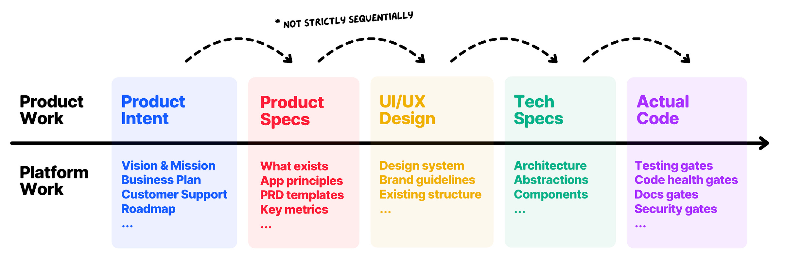

# The Telephone Game of Software

**Source:** [The Telephone Game of Software - by Luca Rossi](https://refactoring.fm/p/the-telephone-game-of-software)

## Summary

Software engineering is a **translation act**: something you want to achieve gets encoded, step by step, into artifacts — specs, designs, architecture, code. Each step is a *lossy translation* that can drop detail or reinterpret it wrongly. Seen this way, shipping software is an elaborate game of telephone, and you win when the original message survives all the way to production. Many engineering practices exist mainly to lower the error rate of that translation.

AI raises the stakes. Models are good enough now that most of their mistakes come from *not understanding what you wanted* rather than bad coding skills. Luca Rossi (with Amelia Wattenberger, Product Lead at Augment Code) argues the answer is not longer specs but better **platform** at every layer, specs treated as a living collaboration surface, and building used as research rather than only as implementation.

## The Journey from Intent to Code

Five stages, though you may skip producing an artifact for some of them:

1. **Product intent** — a one- or two-sentence version of what you want. Often lives only in your head. Example: "add split panes to my editor."
2. **Product specs** — a PRD that stays faithful to the intent while deciding much more: how is it triggered, is there a button, keyboard shortcuts, what happens when you drag a tab between panes.
3. **UI/UX design** — what it looks like, how it behaves, where it lives.
4. **System design** — abstractions to reuse or create, data structures, migrations, instrumentation, testing, rollout and rollback.
5. **Code** — pushed, reviewed, released.

Two properties hold at every hand-off:

- Every step **adds details** the previous step left implicit or never considered.
- Every step is a **chance to lose signal** — to miss a detail or interpret it incorrectly. "Split panes" could legitimately be read as "open the tab in a new window," which is not what you wanted.

Even where no artifact exists, the **decisions still get made** — just invisibly. The goal is to ship value fast, which means avoiding *rework*: code abstractions that match the PRD, a PRD that matches the intent, and no review failure that sends work back to the drawing board.

## Build Platform, Not Bigger Specs

**Spec-driven development** says: to stop the agent building the wrong thing, write a huge detailed spec up front. There is merit — more precise intent gets better results — but two problems:

- **You often don't know what you want yet.** Your understanding benefits from moving back and forth: see a design, build a prototype, click on things. You are simply not in a position to write the full big spec.
- **It optimises the task, not the system.** GitHub's own SDD guidance puts tech stack, legacy systems, compliance requirements and performance targets *in the spec*. But you would never write those in a spec for an engineer on your team — you assume they know, because it is the broader context of their work.

The target: make specs **as short as possible**, containing only the intent specific to the current task, and trust everything else to be inferred from platform.

**Platform work by layer** (each stage of the journey has its own):

- **Product intent** — vision and mission, business plan, customer support, roadmap
- **Product specs** — what already exists, app principles, PRD templates, key metrics
- **UI/UX design** — design system, brand guidelines, existing structure
- **Tech specs** — architecture, abstractions, components
- **Code** — testing gates, code health gates, docs gates, security gates

In the split-panes example, a mature platform already answers most of the spec:

- **Product docs** — other tab actions live as icons in the right panel of the main nav bar, so that's where this goes; an app principle says everything is keyboard-first, so a shortcut is implied.
- **Design docs** — a design file in the repo with a small design system: the same icon set, clear hover and active states, no confusion about what the button looks like.
- **Tech docs** — `ARCHITECTURE.md` and `ABSTRACTIONS.md` record the main tech choices, including where editor state is stored.

With all that in place you are close to being able to say just *"add support for split panes."*

**Questions that reveal where platform is missing:**

- What kinds of things does the AI get wrong most often?
- What do I feel I need to keep reviewing manually?
- What am I not comfortable letting go of control over?
- What lives only in our heads, with no way for AI to figure it out?

## Specs as a Living Collaboration Surface

Treat the spec as a **collaboration surface**, not a static artifact. The AI *enriches* it as work progresses, writing down the details it inferred from your platform and the decisions it made along the way.

You may only say "add split panes," but you still want the full spec written out — so you can **inspect** it and see whether anything was misread, and why.

The spec should **stay at the right altitude** for what you want to inspect: review the product spec before implementation, the tech design write-up before production, and more in between wherever your platform isn't mature enough to let AI run loose. After shipping, keep it in the spirit of an [Architecture Decision Record](https://adr.github.io/) — a snapshot of what was done, not a document to be maintained.

## Building as Research

With coding cheap, building becomes **active research rather than the result of it**: express lightweight intent, let AI fill in the rest, test, repeat. The loop is self-reinforcing — better platform raises product quality *and* shrinks the intent you must specify, which makes product work cheaper still.

The stages are explicitly **not strictly sequential**; they loop and overlap.

## Core Insight

A large share of the cost of software engineering is **translation cost**, and every step from intent to production is a chance to lose signal. We used to manage this with docs occasionally, but mostly with experience, implicit conventions and tribal knowledge — things that lived in our heads. AI now *rewards* making all of that visible, and that's a gift rather than a tax.

The practical shift: stop writing longer specs per task and start investing in the durable context around them. And as the translation work gets automated, humans move to **judgment** — deciding what to build and why, and whether the result is faithful to the original intent.
