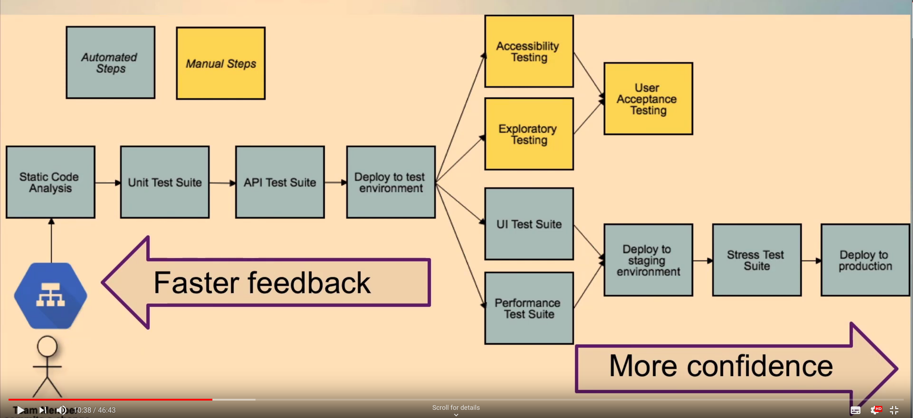

# A Whole Team Approach To Testing In Continuous Delivery (Lisa Crispin)

Created By: Álvaro Bautista Pino
Last Edited: March 18, 2020 8:54 AM

[A Whole Team Approach To Testing In Continuous Delivery - Lisa Crispin](https://www.youtube.com/watch?v=XOElGHrLkUY)

Discussion Points

- Building confidence for CD/Deployment
- Guiding conversations about risk & test coverage
- Quality - A Whole Team Responsibility

Bad experiences:

- Regression Failures: Even when developers automate tests there is still a certain amount of manual UI tests and checklists to pass before going live.
- Exploratory testing was not done because of all of the manual tests we needed to carry on to ensure good security, accessibility...

Collaboration at Story Level

- Exploratory Testing is done by the whole team. Testers train developers on how to do it.
- Testers pair with devs so to help design automated tests

At Epic/Feature Level

- Exploratory Testing charters (Explore It!) go with the stories in the Backlog

Visualize your pipeline, optimize feedback

Test Suite Canvas (to check the Confidence)

[ahunsberger/TestSuiteDesign](https://github.com/ahunsberger/TestSuiteDesign/blob/master/Test%20Suite%20Canvas.png)